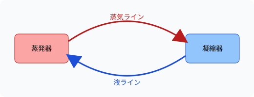

ループヒートパイプ（Loop Heat Pipe, LHP）の動作を、熱抵抗ネットワークと圧力バランスで簡易的に表すメモ。

## 熱抵抗ネットワーク

蒸発器から凝縮器までの熱輸送を、直列の熱抵抗で近似する。

$$
R_{\mathrm{total}} = R_{\mathrm{evap}} + R_{\mathrm{vl}} + R_{\mathrm{cond}}
$$

熱負荷 $Q$ に対する蒸発器温度は

\begin{equation}
  T_{\mathrm{evap}} = T_{\mathrm{sink}} + Q \, R_{\mathrm{total}}
  \label{eq:tevap}
\end{equation}

## 圧力バランス

ウィックの毛細管力が、ループ全体の圧力損失を上回る必要がある。

\begin{equation}
  \Delta P_{\mathrm{cap,max}} = \frac{2 \sigma \cos\theta}{r_{\mathrm{p}}}
  \geq \Delta P_{\mathrm{v}} + \Delta P_{\mathrm{l}} + \Delta P_{\mathrm{w}} + \Delta P_{\mathrm{g}}
  \label{eq:cap}
\end{equation}

ここで $\sigma$ は表面張力、$r_{\mathrm{p}}$ は有効細孔半径。

### 蒸気ラインの圧力損失

層流を仮定すると Hagen–Poiseuille 則より

$$
\Delta P_{\mathrm{v}} = \frac{128 \mu_{\mathrm{v}} L_{\mathrm{v}} \dot{m}}{\pi \rho_{\mathrm{v}} D_{\mathrm{v}}^4},
\qquad
\dot{m} = \frac{Q}{h_{\mathrm{fg}}}
$$

## まとめ

- 式 \eqref{eq:tevap} から、熱抵抗の低減が温度低下に直結する
- 式 \eqref{eq:cap} が輸送限界を決める

記法の詳細は [記事の書き方](../../guide/2026-11-17-how-to-write.md) を参照。
